# Assignment 2 — PlantUML Diagram Source Code
**Project:** Online Food Delivery System — Software Design Description (SDD)
**Group:** Hub (Group 11) · SCSE2233 Software Design and Architecture

> **How to use this file:** Copy each fenced `plantuml` block, paste it into a renderer
> (https://www.plantuml.com/plantuml , the VS Code *PlantUML* extension, or IntelliJ),
> export the image, and paste it into the matching **[Insert ... Diagram Here]** placeholder
> box inside `Assignment2_SDD_OnlineFoodDelivery.docx`. The heading above each block names
> the exact document section and figure number it belongs to.

---

## 1. Figure 5.2.1 — Use Case Diagram (Context Viewpoint §5.2.2)

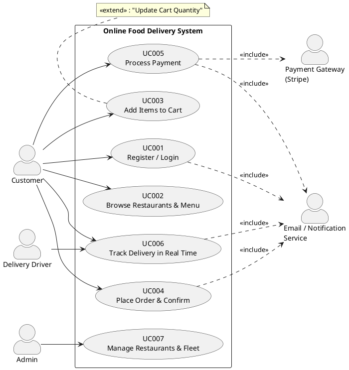

---

## 2. Figure 5.3.1 — Microservices Architecture / Component Diagram (Structure Viewpoint §5.3.2)

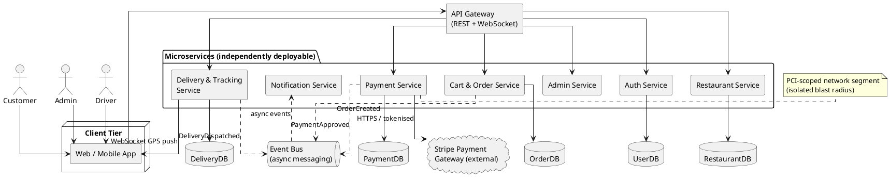

---

## 3. Figure 5.4.1 — Entity Relationship Diagram (Information Viewpoint §5.4.2)

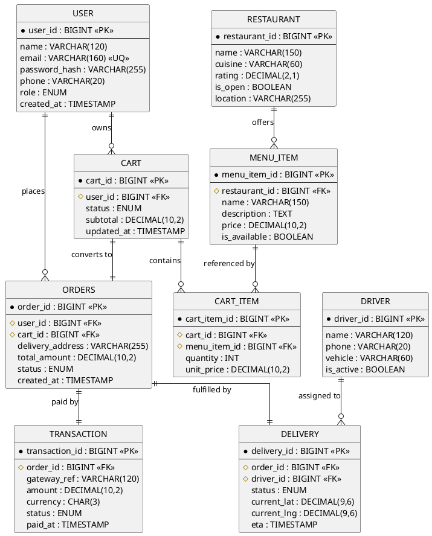

---

## 4. Figure 5.5.1 — UI Wireframes (Interface Viewpoint §5.5.2 / §6)

> Rendered with PlantUML **Salt**. Four key screens on one canvas.

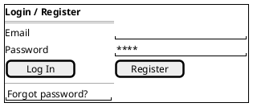

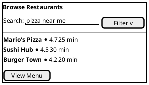

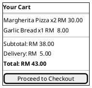

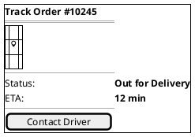

---

## 5. Logical Viewpoint — Pattern-Injected Class Diagrams (§5.6.2)

### 5a. Figure 5.6.1 — Module 1 Class Diagram (Singleton + Proxy + Strategy) — Mohammed Alsakkaf

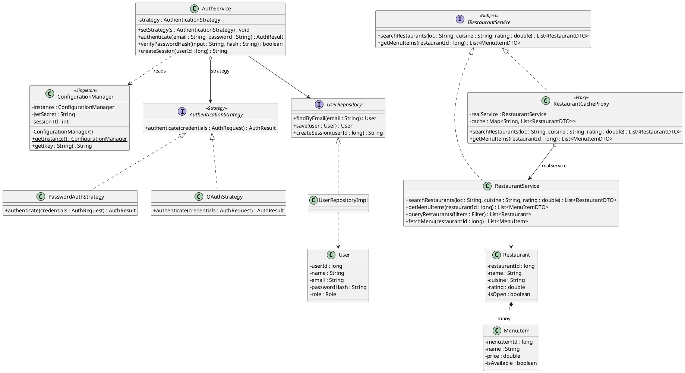

### 5b. Figure 5.6.2 — Module 2 Class Diagram (Builder + Facade + State) — Anas Ahmed Hisham

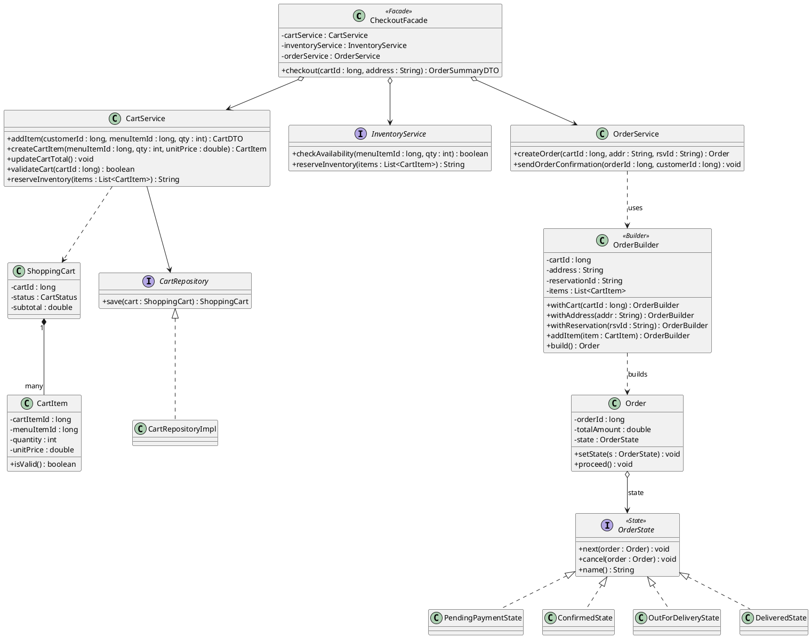

### 5c. Figure 5.6.3 — Module 3 Class Diagram (Factory Method + Adapter + Observer) — Imtiaj

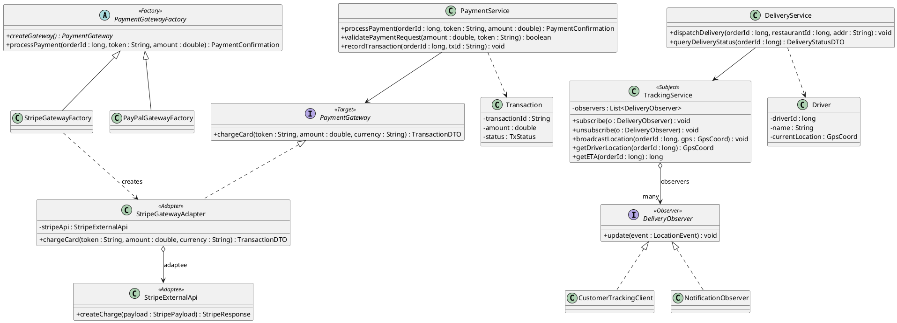

---

## 6. Interaction Viewpoint — Pattern-Aware Sequence Diagrams (§5.7.2)

### 6a. Figure 5.7.1 — SD001: Login & Browse (Strategy + Proxy) — Module 1

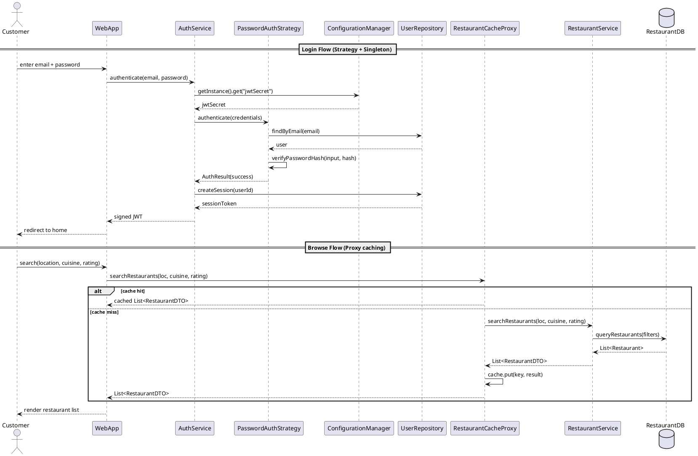

### 6b. Figure 5.7.2 — SD002: Add to Cart & Place Order (Facade + Builder + State) — Module 2

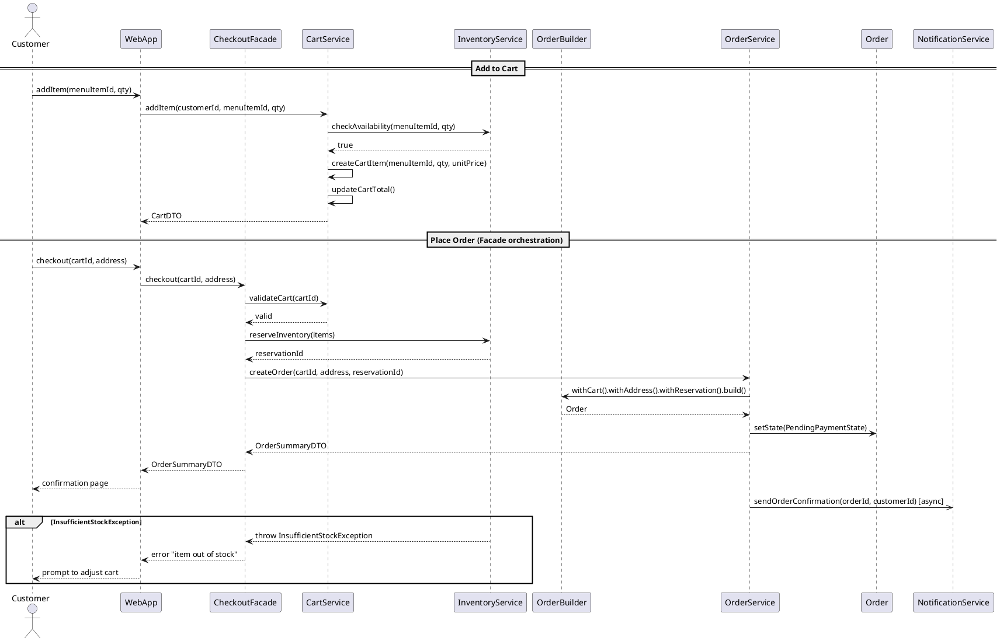

### 6c. Figure 5.7.3 — SD003: Process Payment & Track Delivery (Factory + Adapter + Observer) — Module 3

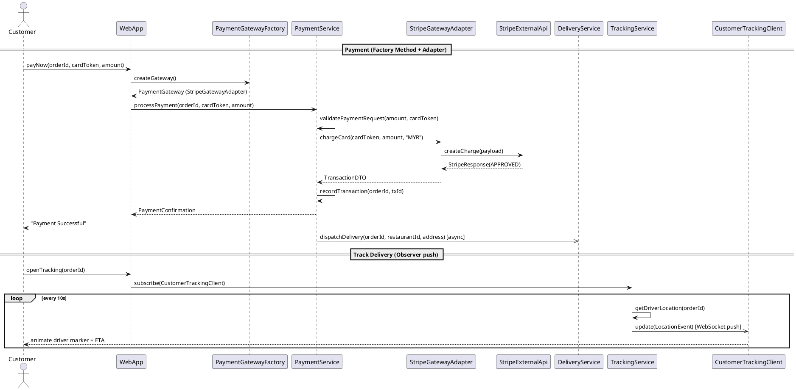

---

## 7. Algorithm Viewpoint — Activity Diagram (§5.8.2)

### Figure 5.8.1 — Activity Diagram: End-to-End Order → Payment → Delivery

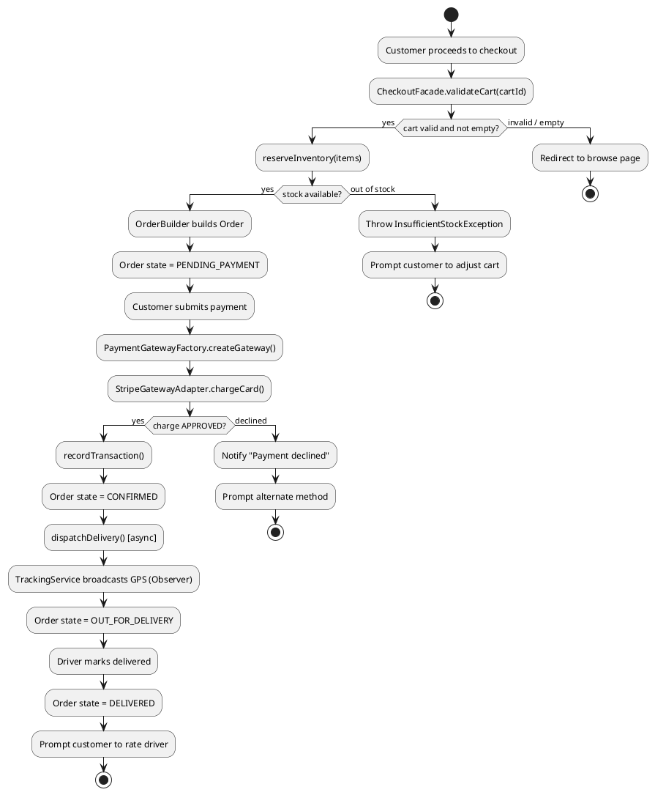

### Figure 5.8.2 — State Machine Diagram: Order Lifecycle (supports the State pattern)

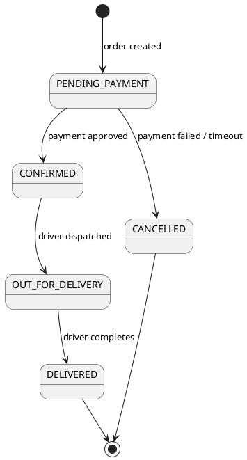

---

*End of PlantUML source. Every method shown in these diagrams matches a method in the
SDD class diagrams (§5.6) and the Java code samples (§5.6.2), and every message in the
sequence diagrams (§5.7) traces to one of those methods — see the Coherence Validation
tables in the main document.*
