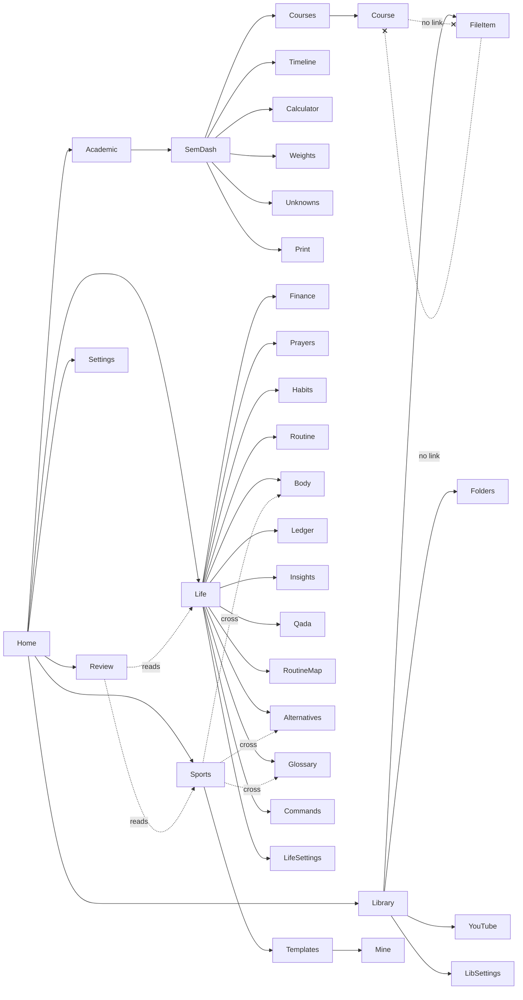
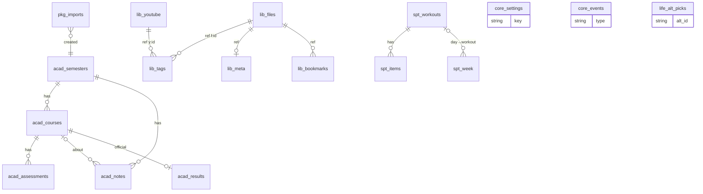

# SYSTEM_MAP — baseline deconstruction (before redesign)

Snapshot of `claude/great-newton-p1ds60` @ 672a17f. ~18.5 k lines TS/TSX (server 3.9 k, shared 2.6 k, web 9.9 k, tests 2.1 k).

## 1. Route tree (web/src/App.tsx — 41 routes, all inside `<Shell>`)

```
/                               Home (launcher: greeting, active-semester hero, 4 platform cards, 3 tiles, quick links)
/home                           → redirect /
/academic                       Semesters manager (CRUD semesters, activate)
/academic/import                Import semester package (Drive link / local folder / listing file)
/academic/s/:semId              SemesterLayout (loads bundle) →
   (index)                      Semester dashboard (week, countdown, tiles, upcoming, week load, courses, weights donut, phases, calendar, timetable, pulse)
   courses                      Courses catalog (cards/list/table, facets, filters, add/edit/delete course, quick add assessment)
   courses/:courseId            Course page (assessments list/table/board, CRUD assessment, CLOs, notes, official result)
   timeline                     Heatmap / Gantt / Scatter / Cumulative
   calculator                   Grade calculator (targets 50/60/70/80, what-if)
   weights                      Weights map (Sankey, by kind, coursework vs final, matrix)
   unknowns                     Unknown items + notes CRUD
   print                        Printable summary
/library                        Library (stats, recent, facets kind/sem/course/type/tag, grouping all/course/semester/type, search, pager)
/library/folders                Folder tree browser
/library/youtube                YouTube links CRUD
/library/settings               Library root + auto-scan interval
/library/f/:id                  File item (PDF viewer w/ resume+bookmarks, docx, image, text, audio/video, Drive iframe; tags, note, progress, done)
/library/y/:id                  YouTube item (player, resume, bookmarks, tags, note)
/life                           Life overview (freshness banner, balances, qada, weight, now/next, habits, missing data)
/life/finance                   Finance (balances, history chart, daily spend, by category, transactions filter)
/life/insights                  Finance indicators (the system text only)
/life/ledger                    Full ledger table (search/type/wallet/date, sort)
/life/prayers                   Prayers attendance + qada totals
/life/qada-plan                 Qada scenarios + local choice (only writable life setting)
/life/habits                    Habits program state
/life/routine                   Routine now/next, prayer times, today schedule
/life/routine-map               Weekly routine map (7 lanes, overlaps)
/life/body                      Body/weight progress
/life/alternatives              "ماذا أسوي الحين؟" alternatives + local picks
/life/glossary                  Glossary (terms with confidence tags)
/life/commands                  Draft commands to the system (write JSON drafts)
/life/settings                  the system folder + file status + the system docs
/review                         Weekly review (Sun–Sat, spec-driven, read-only)
/sports                         Exercise library (body map, filters, safety)
/sports/templates               Weekly templates (choose template/location, copy to my workouts)
/sports/mine                    My workouts builder, weekday assignment, today's card
/settings                       Appearance, notifications, export/import JSON, backups/restore, system info
/search?q=                      Full search results
*                               NotFound
```

## 2. Navigation systems (5 overlapping systems)

| System | Where | Contents | Notes |
|---|---|---|---|
| Platform switcher (pills) | topbar ≥961px; inside sidebar <961px | الفصول · المكتبة · الحياة · الرياضة | Home/Review/Settings are **not** in it |
| Sidebar (per platform) | `plugins.config.tsx` `nav()` | Academic 7–9 entries + semester children; Library 4; Life 14 (12 flat + 2 tools); Sports 3 + 3 cross-links | + fixed "عام" block: الرئيسية, مراجعة الأسبوع, الإعدادات |
| Home platform cards | Home | 4 cards | duplicate of switcher |
| In-page button rows | Library header, Dashboard hero, Life cards | links duplicating sidebar | |
| Palette / search | topbar | 22 pages + 6 semester pages + 3 commands + search hits | nouns only, 3 verbs (theme, notify settings, shortcuts) |
| Keyboard `g x` | Shell | 10 targets | academic-centric |
| Bell | topbar | upcoming deadlines (assessments) | academic only |

### Navigation graph (main edges)

Dead ends / missing interchanges: course ↔ its library files (only implicit via course_hint facet), assessment ↔ files, workout ↔ Home/Today, Review → nothing editable, Settings ↔ Library/Life settings (3 separate settings pages).

## 3. API (server/*.ts — 66 endpoints)

| Router | Endpoints |
|---|---|
| core (`routes.ts`) | GET health, info · semesters: GET list, POST, GET :id, PATCH :id, POST :id/activate, DELETE :id · courses: POST semesters/:id/courses, PATCH :id, DELETE :id · assessments: POST courses/:id/assessments, PATCH :id, DELETE :id · notes: POST semesters/:id/notes, PATCH :id, DELETE :id · POST undo/:token · GET search · GET export · POST import/preview, import/apply · GET/POST backups, POST backups/restore |
| library | GET status, PUT settings, POST scan, GET items, tree, recent, tags, item/:ref, files/:id/raw|text|docx · youtube POST/GET/PATCH/DELETE · PUT tags/:ref, meta/:ref · POST open/:ref · bookmarks GET/POST, PATCH/DELETE bookmark/:id |
| life | GET status, PUT settings, GET data/:name, bundle, docs/:name, content/:name, GET/PUT qada-choice, GET/POST commands |
| sports | GET mine, POST workouts, PATCH workouts/:id, PUT workouts/:id/items, DELETE workouts/:id, PUT order, PUT week, PUT settings, GET/PUT alt-picks · (+ static content via life content) |
| search | GET more |
| packages | GET /, POST preview, POST apply, GET results/:semId |

## 4. Data model (schema v4)


External read-only sources: the system exports (`seed/*.json`, docs), library folder scan, Drive package listings, static content (`content/*` exercises, templates, glossary).

## 5. CRUD matrix (before)

✓ = in UI · ✗ = missing · — = not applicable (external/read-only)

| Entity | Create | Read | Update | Delete | Bulk | Undo | Share/Publish | Import | Export | History |
|---|---|---|---|---|---|---|---|---|---|---|
| Semester | ✓ /academic | ✓ | ✓ | ✓ | ✗ | ✓ toast 9 s (server 10 min, in-memory) | ✗ (package = CLI script only) | ✓ JSON, package | ✓ JSON (all) | ✗ |
| Course | ✓ | ✓ | ✓ | ✓ | ✗ | ✓ toast | ✗ | via semester | via all | ✗ |
| Assessment | ✓ | ✓ | ✓ (form; status quick toggle) | ✓ | ✗ | ✓ toast | ✗ | via semester | via all | ✗ |
| Note / unknown | ✓ | ✓ | ✓ | ✓ | ✗ | ✓ toast | ✗ | via semester | via all | ✗ |
| Official result | — package | ✓ | ✗ | ✗ | ✗ | ✗ | ✗ | ✓ package | ✗ | ✗ |
| Library file | — scan | ✓ | tags/note/progress/done ✓ | — | ✗ | ✗ | ✗ | ✓ package/Drive | ✗ | ✗ |
| YouTube link | ✓ | ✓ | ✓ | ✓ | ✗ | **✗** | ✗ | ✗ | ✗ | ✗ |
| Bookmark | ✓ | ✓ | ✓ | ✓ | ✗ | **✗** | ✗ | ✗ | ✗ | ✗ |
| Workout | ✓ | ✓ | ✓ | ✓ | ✗ | **✗** | ✗ | ✗ | ✗ | ✗ |
| Week assignment | ✓ | ✓ | ✓ | ✓ | ✗ | ✗ | ✗ | ✗ | ✗ | ✗ |
| Alt pick / qada choice | ✓ | ✓ | ✓ | ✓ | — | ✗ | ✗ | ✗ | ✗ | ✗ |
| Command draft (to the system) | ✓ | ✓ | ✗ | ✗ | ✗ | ✗ | (file drop) | — | — | ✗ |
| the system life data | — | ✓ | — | — | — | — | — | — | — | — |
| **Anything user-defined** | **✗ impossible** | | | | | | | | | |
| Relations between any two things | ✗ | | | | | | | | | |
