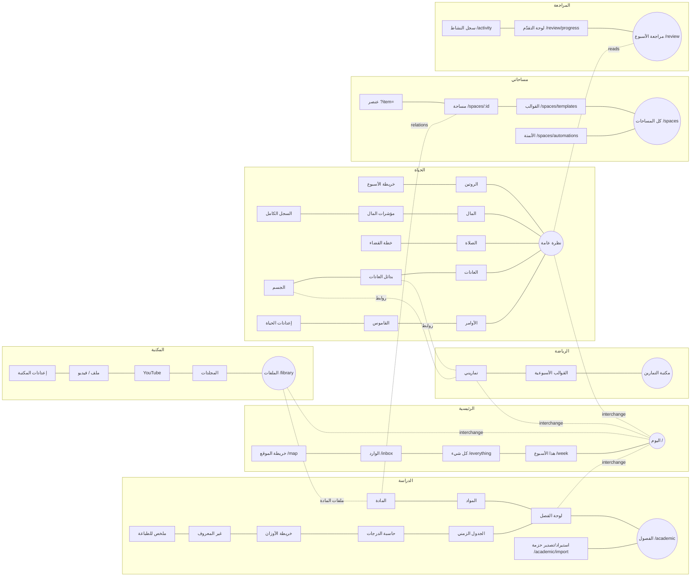

# IA_METRO_MAP — the new information architecture

> Inside like a train network, outside effortless. **Lines** = domains, **stations** = pages/views, **interchanges** = cross-domain links, **central station** = Home.

Single source of truth in code: `web/src/core/metro.ts` (lines, stations, interchanges). The sidebar, top line switcher, mobile bottom bar, breadcrumbs, palette, keyboard shortcuts and the `/map` page are all generated from it — they cannot drift apart.

## 1. Lines (7 top-level — Hick budget ≤ 7)

| # | Line | Color token | Base | Purpose (user goal) |
|---|---|---|---|---|
| 1 | **الرئيسية** (central station) | `--core` | `/` | What now? Today · This week · Everything · Inbox |
| 2 | **الدراسة** | `--acad` | `/academic` | Semesters → courses → assessments, grades, packages |
| 3 | **المكتبة** | `--library` | `/library` | Files, folders, videos; reading progress |
| 4 | **الحياة** | `--life` | `/life` | Money, worship, habits, routine, body (Rashed data, read-only) |
| 5 | **الرياضة** | `--sports` | `/sports` | Exercises, templates, my workouts |
| 6 | **مساحاتي** | `--spaces` | `/spaces` | Anything else: user-defined spaces, types, templates, automations |
| 7 | **المراجعة** | `--review` | `/review` | Weekly review, progress dashboard, activity history |

Global (not lines, fixed placement in the topbar): Search/Palette · Create (+) · Inbox bell · Settings & data · theme.

## 2. Stations (≤ 3 levels to any object)

Depth check: Home → line → station → object. Deepest object (an assessment) = الدراسة → لوحة الفصل → المادة (#anchor) = 3 levels; a space item = مساحاتي → مساحة → عنصر (drawer) = 3.

## 3. Interchanges (cross-line links, shown as «تقاطعات» in the sidebar and as "مرتبط بـ" on objects)

| From | To | Mechanism |
|---|---|---|
| Today (Home) | due assessments, today's workout, prayers/habits, money, continue reading, inbox | Home cards (each card header links to its station) |
| Course page | library files of that course | "ملفات المادة" card (library query `course=CODE`) |
| Library item | its course | "المادة" chip when `course_code` matches a known course |
| Any object | any object | Relations panel (typed links, backlinks) |
| Sports → Life | alternatives, body | «تقاطعات» group (was mixed into Sports nav) |
| Review | Life, Sports, Study | source links per section |

## 4. Old → new route map (all old URLs kept — D3)

| Old URL | New home | Change |
|---|---|---|
| `/` | الرئيسية › اليوم | content rebuilt (Today); old hero + line cards kept below |
| `/home` | → `/` | redirect (unchanged) |
| `/academic…` (all 10) | الدراسة | same URLs; view switcher added on semester pages |
| `/library…` (6) | المكتبة | same URLs; header duplicate buttons → view tabs |
| `/life…` (14) | الحياة | same URLs; sidebar grouped (4 groups + tools) |
| `/sports…` (3) | الرياضة | same URLs; cross-links moved to «تقاطعات» |
| `/review` | المراجعة › مراجعة الأسبوع | same URL; now a line |
| `/settings` | global › الإعدادات والبيانات | same URL; hub links to library/life settings, trash, profile |
| `/search` | global | same URL |
| new | `/week` `/everything` `/inbox` `/map` `/spaces…` `/review/progress` `/activity` `/trash` `/p/:token` | aliases: `/study`→`/academic`, `/today`→`/`, `/settings/trash`→`/trash` |
